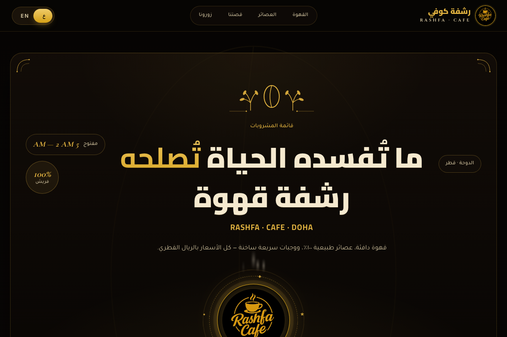
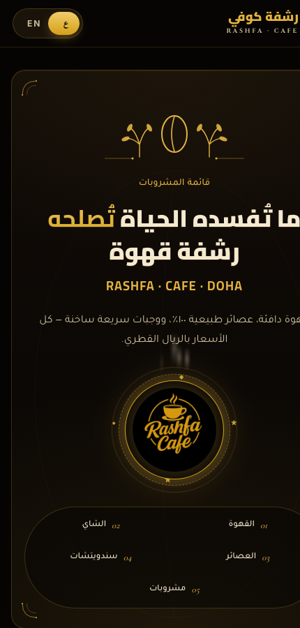

# Rashfa Cafe · Bilingual Digital Menu

> A right-to-left Arabic / English digital menu for **Rashfa Cafe — Doha, Qatar**, built as a
> zero-dependency static site and shipped to the client as a **single self-contained HTML file**.

| Desktop | Phone |
|:---:|:---:|
|  |  |

**Live demo:** https://hamarigo.github.io/rashfa-cafe-restaurent-menu/

---

## Documentation

| Read | For |
|---|---|
| [ARCHITECTURE](docs/ARCHITECTURE.md) | how the page loads, the data/behaviour split, language switching, the build |
| [BUNDLE-FORMAT](docs/BUNDLE-FORMAT.md) | the `__bundler` container field by field, and the eight steps its loader takes |
| [DESIGN-SYSTEM](docs/DESIGN-SYSTEM.md) | palette, the five typefaces and which job each does, motion, RTL mirroring, breakpoints |
| [KNOWN-ISSUES](docs/KNOWN-ISSUES.md) | nine measured defects, what each costs, and what was deliberately left alone |
| [CONTENT-EDITOR](docs/CONTENT-EDITOR.md) | changing a price, adding an item, swapping a photo |
| [DEPLOYMENT](docs/DEPLOYMENT.md) | three ways to ship it, caching, print behaviour |
| [CONTRIBUTING](CONTRIBUTING.md) | setup, the one rule about `dist/`, conventions, what CI asserts |
| [CHANGELOG](CHANGELOG.md) | what shipped, what was fixed after the fact |

## At a glance

| | |
|---|---|
| Menu items | **43** across **5** categories (coffee, tea, fresh juice, fast food, cold drinks) |
| Languages | Arabic (default, `dir="rtl"`) and English, toggled live |
| Dependencies | **Zero** — no framework, no bundler, no runtime libraries |
| Deliverable | One `.html` file that carries its own images and scripts |
| Build tools | 663 lines of Python standard library, no third-party packages |
| Prices | 10–25 QAR, formatted to two decimals in the display font |

The whole thing is a single page: ambient hero, marquee ribbon, value cards, the menu itself,
three signature items, a story block, a six-tile photo gallery, a visit/CTA strip with QR, and a footer.

---

## Why this repo is structured the way it is

The interesting engineering problem here was not the design — it was the **delivery format**.

What the client received is one 4 MB HTML file with no accompanying folders: open it in any
browser, from a USB stick, an email attachment or a WhatsApp file, and the site works. To get
there, the page is stored as a JSON string inside a `<script type="__bundler/template">` block,
every image and script is base64'd into a manifest block keyed by UUID, and a small loader
decodes each entry into a `blob:` URL and swaps the UUID placeholders in at runtime.

That format is great to ship and **terrible to maintain** — you cannot read it, diff it, or edit
a price in it. So this repo keeps both, generated by tools rather than by hand:

```
   site/  ──────────tools/bundle.py────────▶  dist/rashfa-cafe-menu.html
   readable source                            one self-contained file
        ▲
        └──────────tools/unpack.py──────────  the delivered artifact
```

- **[`site/`](site)** — the real source: `index.html`, three stylesheets, menu data separated
  from render logic, images with human names.
- **[`dist/`](dist)** — the packaged single-file build, reproducible from `site/`.
- **[`tools/`](tools)** — the packer, the unpacker, and a verification script.

Asset UUIDs in the build are derived with `uuid5` over the asset path, so **two builds of the
same source produce byte-identical output** — which makes `dist/` safe to commit and to diff.

The reverse-engineered format is written up in [docs/BUNDLE-FORMAT.md](docs/BUNDLE-FORMAT.md).

---

## Quick start

No install step. Python 3.9+ and a browser.

```bash
# view the source site
python3 -m http.server 8000 --directory site
# → http://localhost:8000

# rebuild the single-file deliverable
python3 tools/bundle.py

# check everything still holds together
python3 tools/verify.py            # static checks
python3 tools/verify.py --browser  # also renders dist/ in headless Chrome
```

`tools/verify.py --browser` is the one to run before committing: it rebuilds `dist/`, renders it
in headless Chrome, and asserts that all 5 categories and 43 items appear, that images resolve as
blob URLs, and that no font placeholder is left dangling.

To edit the menu, open [`site/js/menu-data.js`](site/js/menu-data.js) — it is pure data with no DOM
references, which is why it is split out from the render code.

---

## Project layout

```
rashfa-cafe-restaurent-menu/
├── site/                        readable source (the thing you edit)
│   ├── index.html               page structure, RTL-first
│   ├── css/
│   │   ├── main.css             design system, layout, motion        (43 KB)
│   │   ├── photo-integration.css                                    (2 KB)
│   │   └── fonts.embedded.css   original @font-face rules, unlinked (28 KB)
│   ├── js/
│   │   ├── menu-data.js         43 items, 5 categories, prices
│   │   ├── menu-app.js          render, language toggle, scroll reveals
│   │   └── photo-focal.js       in-page photo repositioning tool
│   └── img/                     10 photographs + logo
├── dist/
│   └── rashfa-cafe-menu.html    single-file build (4 MB, reproducible)
├── tools/
│   ├── bundle.py               site/  → dist/
│   ├── unpack.py               bundle → site/
│   ├── verify.py               consistency + render checks
│   └── loader-head.html        the runtime unpacker embedded in dist/
├── .github/workflows/
│   └── ci.yml                   verify → fail on stale dist/ → publish Pages
├── docs/
│   ├── ARCHITECTURE.md          how the page is put together
│   ├── DESIGN-SYSTEM.md         palette, type, motion, bilingual/RTL rules
│   ├── BUNDLE-FORMAT.md         the single-file format, field by field
│   ├── CONTENT-EDITOR.md        changing prices, items, photos, text
│   ├── DEPLOYMENT.md            the single file, Pages, any static host
│   └── KNOWN-ISSUES.md          real defects, measured, with fixes
├── CONTRIBUTING.md              workflow, conventions, what the checks cover
└── CHANGELOG.md                 delivery history and the tooling fixes
```

---

## Things worth pointing at

**Bilingual without duplicated markup.** Every translatable string is a pair of spans
(`.t-ar` / `.t-en`) inside one element — 62 of each on this page. Switching language sets `lang`
and `dir` on the root element, and CSS hides the inactive pair. Most of the mirrored layout comes
free from the browser's own RTL flow; the handful of places it does not (asymmetric paddings,
alignment of the price column, the ribbon direction) are handled by 11 `[dir="rtl"]` /
`[dir="ltr"]` scoped overrides rather than a second stylesheet. The choice persists in
`localStorage` under `rashfa-lang`.

**A content tool for the client, not a CMS.** [`photo-focal.js`](site/js/photo-focal.js) adds a
draggable panel of sliders that adjust `object-position` on each baked-in photograph, so the
owner can recompose a crop without touching CSS. Values persist to `localStorage` under
`rashfa-photo-focal`, so an adjustment survives a reload on that device. It stays hidden until
the host frame posts `__activate_edit_mode` — see the caveat in
[docs/KNOWN-ISSUES.md](docs/KNOWN-ISSUES.md) #4 about what it does *not* do.

**Motion that degrades.** Seven keyframe animations (falling beans, rising bubbles, rotating
rings, escaping steam, a scrolling ribbon) are all driven by CSS custom properties set inline per
element (`--x`, `--d`, `--s`, `--o`), so the ambient field is data rather than markup. Scroll
reveals use a single `IntersectionObserver` that unobserves each node after it fires.

**A print stylesheet.** `@media print` exists in `main.css` — the menu prints cleanly as a
paper sheet, which a cafe actually needs.

---

## Known issues

Documented honestly in [docs/KNOWN-ISSUES.md](docs/KNOWN-ISSUES.md). The short version:

1. **The delivered bundle lost its typography.** 74 `@font-face` rules in the shipped file point
   at UUID placeholders that were never in the manifest, so they silently fall back to system
   fonts offline. Found by rendering the original and diffing the DOM. Fixed in `site/` with a
   live Google Fonts sheet.
2. **One photograph is a raw phone export** — 2268×4032, 2.4 MB, which is 78% of the payload for
   a tile displayed at a few hundred pixels wide. Resizing it would cut the deliverable roughly
   in half.
3. **The menu is JS-rendered**, so item names and prices are absent from the static HTML — fine
   for a QR-linked in-person menu, wrong for SEO.
4. **Six of the twelve photo-crop sliders did nothing.** Their selectors point at `sig-mojito`,
   `sig-turkish` and `sig-avocado`, and no element carries those classes; `applyAll()` skips a
   null match without a word, so the slider moves and the image never does. Fixed, and now
   asserted by `verify.py`.

---

## Tech stack

`HTML` · `CSS` (custom properties, `@font-face`, keyframes, `IntersectionObserver`) ·
`vanilla JavaScript` (ES2020, no framework) · `Python 3` standard library (`base64`, `gzip`,
`json`, `uuid`, `re`) for the build tools · `Google Fonts` (Cairo, Tajawal, Inter,
Cormorant Garamond, Cinzel) · headless Chrome for verification.

---

## Licensing and attribution

The **source code and build tooling** in this repository are released under the
[MIT License](LICENSE) so the technique can be reused and inspected.

That licence **does not cover the client's material**: the Rashfa Cafe name, logo and brand
assets, the photography, the menu content and prices belong to **Rashfa Cafe** and are shown here
only as a portfolio record of the work. Please do not reuse them. If you are the client and would
prefer this removed, open an issue and I will take it down.

---

## Author

**Mohamed Bouallagui** — Senior Full-Stack Engineer · [GitHub](https://github.com/HamaRigo)

Built for Rashfa Cafe, Doha, Qatar.
